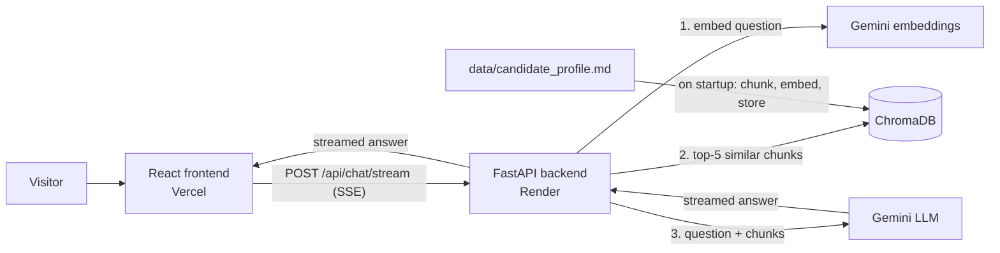

# Chat with Chris's CV: a RAG chatbot

An end-to-end Retrieval-Augmented Generation (RAG) app. Recruiters can ask questions about my background and get answers grounded in my CV, streamed back in real time.

**Live demo:** https://rag-chatbot-psi-liart.vercel.app/

> The backend runs on a free hosting tier that sleeps when idle. If it is asleep, the first load takes up to about a minute; the page shows a "Waking up the server…" banner and unlocks automatically once it is ready.

## Why I built this

I wanted a portfolio piece that is more than a static page: something a recruiter can interact with, and that shows I can design, build, and deploy a full-stack AI application, not only call an LLM API. I'm a frontend developer moving into full-stack work, so I built both sides myself: the Python API, the retrieval pipeline, the React UI, and the deployment.

## How it works



1. **Ingest (on server startup).** The knowledge base (`data/candidate_profile.md`) is split into chunks by section heading, each chunk is embedded with `gemini-embedding-001`, and the vectors are stored in ChromaDB.
2. **Retrieve.** A visitor's question is embedded the same way, and the 5 most similar chunks are fetched.
3. **Generate.** The question and those chunks are sent to `gemini-3.5-flash-lite` with instructions to answer only from the provided material. The answer streams back to the browser as Server-Sent Events.

## Tech stack

| Layer | Choice |
|---|---|
| Frontend | React 19, Vite, Tailwind CSS, react-markdown |
| Backend | Python, FastAPI, Uvicorn |
| Vector store | ChromaDB (embedded, file-based) |
| AI | Google Gemini API (embeddings + chat) |
| Hosting | Vercel (frontend), Render (backend), both on free tiers |

## Design decisions

### Why ChromaDB (embedded) instead of a hosted vector database

My knowledge base is a single CV, around a dozen chunks. A hosted vector database would add cost, an account, and a network hop for no benefit at this size. ChromaDB runs inside the backend process and needs no external service.

The trade-off: the free hosting tier has an ephemeral disk, so the database disappears on every restart. Because the corpus is tiny, rebuilding it costs one batch of embedding requests, so I made rebuilding automatic instead of paying for persistent storage. On startup the server fingerprints (SHA-256) the knowledge base file and compares it with a fingerprint stored in the collection. If the database is missing or the CV has changed, it rebuilds; otherwise it skips the work. For a much larger corpus I would move to a persistent store.

### Handling cold starts on free hosting

Render's free tier spins the service down after 15 minutes without traffic, and waking it takes around a minute (I measured about 50 seconds). Rather than let the page look broken, the frontend:

- pings `/api/health` when the page opens and shows a "Waking up the server…" banner if there is no quick answer,
- retries every 3 seconds for up to about 90 seconds, locks the input while waiting, and unlocks it as soon as the server responds,
- shows a clear error if the server never comes up, and friendly messages for rate limits and interrupted answers.

On the backend, transient Google errors (429 and 503) are retried automatically before an error is shown.

### Security and cost safeguards

This is a public site backed by a free API quota, so I treated abuse as a real concern:

- **No upload feature.** The first version of my plan included file upload. I removed it: anyone could have injected false statements about me into the knowledge base, which the chatbot would then repeat to recruiters. The knowledge base can only be changed by committing to the repository.
- **Secrets stay out of the repo.** The API key lives in environment variables (`.env` locally, the hosting dashboards in production) and is git-ignored. I checked the full git history for keys and secret files before pushing to this public repository.
- **CORS allowlist.** The backend only accepts browser requests from the deployed frontend's origin.
- **Input limits.** Questions are limited to 500 characters, validated on the server.
- **Grounded answers.** The system prompt tells the model to answer only from the retrieved material and to say so when it does not know. I tested this by asking for my phone number, which is deliberately not in the knowledge base: the bot declines and points to my email.

## API

| Method | Path | Description |
|---|---|---|
| `GET` | `/api/health` | Liveness check (also used to wake the server) |
| `POST` | `/api/chat/stream` | Body: `{"question": "..."}`. Responds with Server-Sent Events: `{"text": "..."}` pieces, then `{"done": true}` (or `{"error": "..."}`) |

## Project structure

```
backend/
  main.py            app setup, CORS, startup database build
  config.py          models, paths, limits (one place to change them)
  ingest.py          chunking, embedding, ChromaDB storage
  rag_chain.py       retrieval + streamed generation
  api/               one file per endpoint group (health, chat)
frontend/
  src/api/           client for the streaming API
  src/components/    chat UI components
  src/hooks/         server wake-up detection
data/
  candidate_profile.md   the knowledge base
render.yaml          Render deployment blueprint
```

## Run it locally

You need Python 3.14 (what I developed and deployed with), Node.js, and a [Gemini API key](https://aistudio.google.com/).

```bash
# 1. Add your key
cp .env.example .env        # then edit .env and set GEMINI_API_KEY

# 2. Backend (http://localhost:8000)
cd backend
python3 -m venv .venv
source .venv/bin/activate
pip install -r requirements.txt
uvicorn main:app --reload

# 3. Frontend (http://localhost:5173), in a second terminal
cd frontend
npm install
npm run dev
```

The first backend start builds the vector database automatically.

## Known limitations and next steps

- **"List everything" questions.** Retrieval returns a fixed number of chunks (5), so a question like "list all my work experience" could miss items as the knowledge base grows. My planned fix: classify the question type first, then fetch every chunk tagged with that category instead of relying on a fixed top-K.
- **Knowledge base scope.** It currently contains my CV only. Coursework, project write-ups, and an explanation of this project are planned additions.
- **No automated tests yet.** I verified the pipeline, error paths, and deployment manually.
